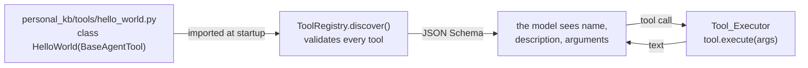

# Add a tool to the agent

A tool is something the agent can do besides answering from memory: look up the SDD specs today, tomorrow a Jira
ticket or an HR record. This guide adds a `hello_world` tool that greets a person by name, from the first file to a
chat that uses it. Follow it as written; it takes about 20 minutes.

**What you need:** the stack running (`docker compose up -d` from the repo root, see the [README](../README.md)) and
`uv` for the tests (`cd backend && uv sync`). The `kb-backend` image bakes the code in, so after adding the tool
rebuild it with `docker compose up -d --build backend` before trying it in the running stack.

## How tools work



- **Discovery:** every subclass of `BaseAgentTool` defined in a module directly inside `personal_kb/tools/` is
  registered when the app starts. There is no list to edit. A module in a sub-folder is not found.
- **The model chooses from the description:** it decides when to call your tool by reading `description`, and fills
  the arguments from `args_schema` (a Pydantic model; each field's `description` is shown to it too). A class
  docstring is for developers only: the model never sees it.
- **Validation at startup:** a `name` not matching `^[a-z][a-z0-9_]{2,63}$`, a description under 10 words, or two
  tools with the same name stop the app at startup, with a Pydantic error naming the problem.
- **A tool never crashes a chat:** `execute()` (in `base.py`) validates the arguments, applies `timeout_seconds`
  (30 s by default) and turns any error into a text starting with `Lỗi:`, which the agent reads and explains. Your
  `run()` only does the work.
- **Tools about the specs** (`search_sdd_knowledge`, `get_full_spec_content`, `list_sdd_specs`) also make the agent
  read the relevant specs whole; any other tool runs alone.

## Step 1 — Create the tool

Create `backend/personal_kb/tools/hello_world.py`:

```python
"""Hello world: the smallest agent tool (docs/add-a-tool.md)."""

from pydantic import BaseModel, Field

from personal_kb.tools.base import BaseAgentTool, ToolContext


class HelloArgs(BaseModel):
    name: str = Field(description="Tên người cần chào, ví dụ: An", min_length=1, max_length=50)


class HelloWorld(BaseAgentTool):
    name: str = "hello_world"
    description: str = (
        "Chào một người theo tên bằng câu Hello World. Chỉ dùng khi người dùng yêu cầu rõ công cụ hello_world "
        "hoặc muốn được chào bằng công cụ này."
    )
    args_schema: type[BaseModel] = HelloArgs
    status: str = "👋 Đang chào {name}..."  # shown in the chat while the tool runs; {name} is the argument

    async def run(self, args: HelloArgs, ctx: ToolContext) -> str:
        return f"Hello World, {args.name}!"
```

What each part does:

| Part | Rule |
|---|---|
| `HelloArgs` | The arguments, as a Pydantic model. Give every field a `description`: the model reads it. Constraints (`min_length`, `max_length`, patterns) are checked before `run`. |
| `name` | Lowercase letters, digits and `_`, 3 to 64 characters, unique among the tools. |
| `description` | At least 10 words. Say **what** the tool does and **when** to use it (and when not). Write it in the users' language. |
| `status` | Optional. What the chat shows while the tool runs; `{argument}` placeholders are filled from the call. |
| `run(args, ctx)` | `async`, returns a string the agent will read. `args` is a `HelloArgs`. `ctx.retriever` and `ctx.documents` are the SDD stores, if your tool needs them. |

## Step 2 — Test it

Create `backend/tests/test_hello_world.py`:

```python
from personal_kb.tools.base import ToolContext
from personal_kb.tools.hello_world import HelloWorld
from personal_kb.tools.registry import ToolRegistry


async def test_hello_world_greets_by_name():
    assert await HelloWorld().execute({"name": "An"}, ToolContext(None, None)) == "Hello World, An!"


async def test_bad_arguments_come_back_as_text_not_as_an_error():
    answer = await HelloWorld().execute({}, ToolContext(None, None))

    assert answer.startswith("Lỗi: tham số không hợp lệ")


def test_hello_world_is_registered_at_startup():
    assert "hello_world" in ToolRegistry.discover().names
```

Run it, then the whole suite and the linter:

```sh
cd backend
uv run pytest tests/test_hello_world.py
uv run --env-file ../.env pytest
uv run ruff check . && uv run ruff format --check .
```

## Step 3 — Run it by hand

In development the backend reloads on file changes, so the tool is live already:

```sh
cd ai
docker compose exec backend python -m scripts.run_tool --list
docker compose exec backend python -m scripts.run_tool hello_world '{"name": "An"}'
```

`--list` prints every tool's schema, `hello_world` among them; the second command prints `Hello World, An!`. The
startup log shows it too: `docker compose logs backend | grep ToolRegistry`.

## Step 4 — Let the agent use it

```sh
docker compose exec backend python -m scripts.chat "Dùng công cụ hello_world để chào An"
```

The log traces the graph:

```text
[Agent] Agent_Thinking -> Tool_Executor: hello_world({'name': 'An'})
[Agent] Tool_Executor ran hello_world
[Agent] Agent_Thinking -> END
```

In the chat UI the status line shows "👋 Đang chào An..." while the tool runs. With Langfuse on, the trace of the
turn shows the `hello_world` tool span with its arguments and output ([handover](handover.md#langfuse)).

On a server (no reload), rebuild the backend image: `docker compose up -d --build ai-backend`.

## Pitfalls

| Symptom | Cause |
|---|---|
| The app does not start: `a tool description needs at least 10 words` | Write a longer description. |
| `two tools are named …` | Another tool has the same `name`. |
| The tool never appears in `--list` | The module is not directly inside `personal_kb/tools/`, or the class does not override `run`. |
| The agent never calls the tool | The description does not say when to use it; say it plainly, in the users' language, and test with a question that matches. |
| The agent gets `Lỗi: tham số không hợp lệ` | The model sent arguments the schema refuses; describe the fields better. |
| `Lỗi: công cụ … chạy quá thời gian` | `run` took longer than `timeout_seconds` (30 s); raise it on the class if the work is legitimately slow. |

## Beyond Hello World

- **Calling another service** (Jira, an HR API): read its URL and token from `Settings`
  (`personal_kb/core/config.py`, as optional fields) and create the client in `bootstrap.py`; pass it to tools by adding
  a field to `ToolContext` (`tools/base.py`). Never put a secret in a description or a returned text.
- **When the service is down**, raise `DependencyUnavailableError("jira", reason)` from `run`: the agent then tells
  the user the service is unavailable instead of guessing.
- **Keep the answer honest:** return what the service said, as text the agent can quote; the agent's checks only
  accept citations and technical names that a tool returned.
