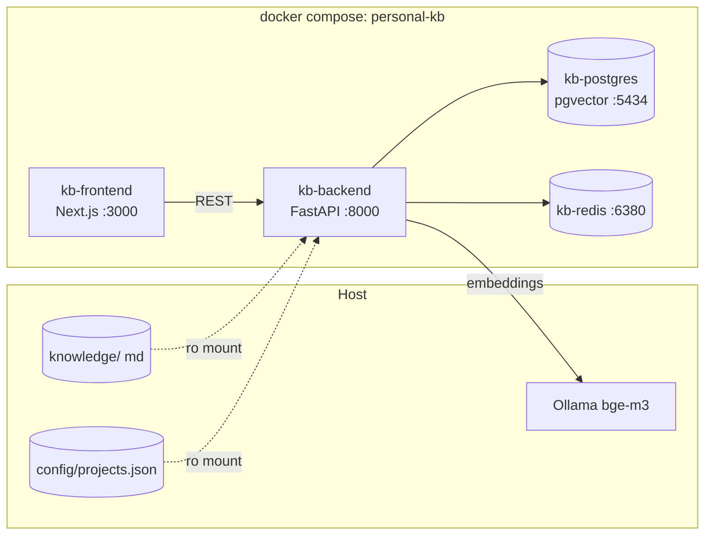
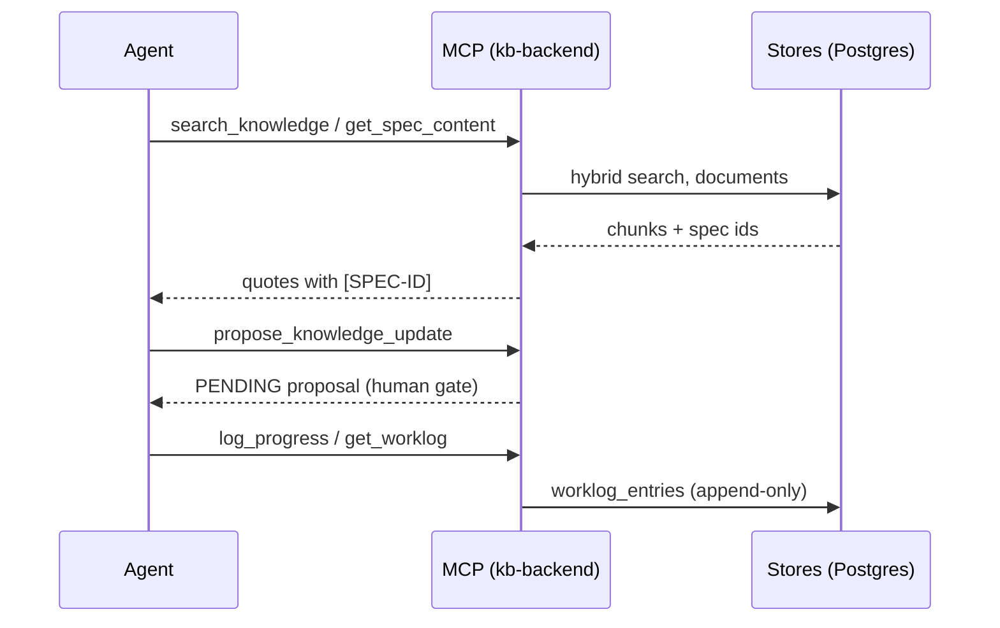
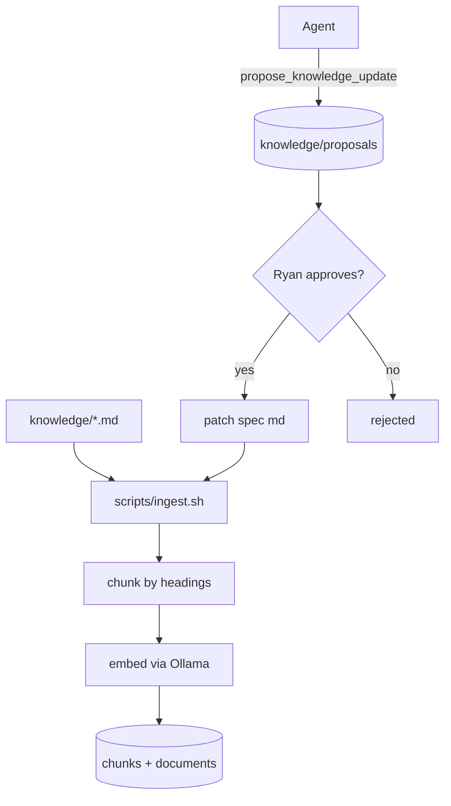
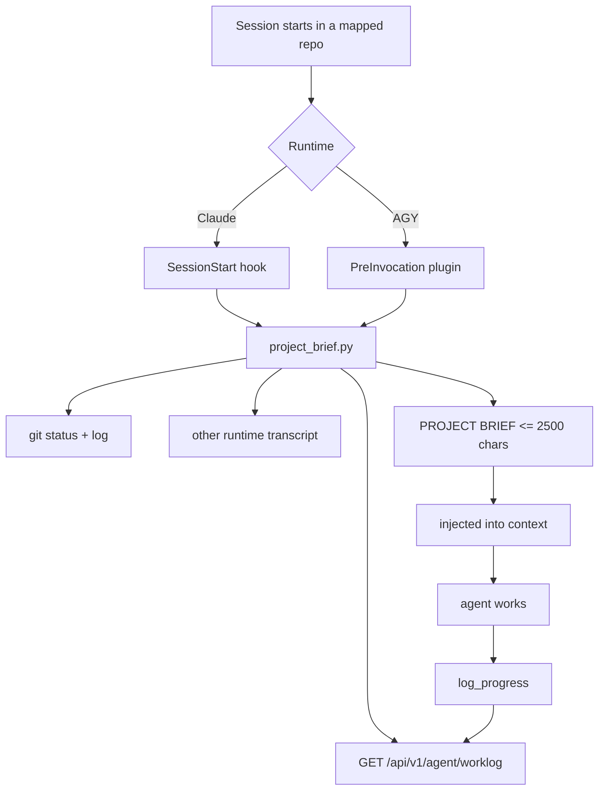

# Architecture

Personal-KB is a local knowledge base for AI agents. Requirements live as Markdown in `knowledge/` and change only
through human-approved proposals; agent progress lives in an AI-writable worklog. Agents reach both over MCP; people
use the web portal. Everything runs on one machine with Docker.

## 1. Runtime stack

All published ports bind to `127.0.0.1`. Embeddings come from Ollama on the host (`bge-m3`, 1024 dims); the chat
model is any OpenAI-compatible API (`OPENAI_BASE_URL`, default DeepSeek).

## 2. How agents use it (MCP)

Claude Code and Antigravity (AGY) start the MCP server over stdio with `scripts/mcp_server.sh`, which runs
`python -m personal_kb.mcp.cli` on the host from `backend/.venv`, reaching Postgres, Redis, Ollama and the re-ranker on
their host ports with the backend's compose settings. It used to run inside `kb-backend` through `docker exec`, and
every open session lost MCP whenever that container restarted, since the clients never reopen a stdio server. Without
`backend/.venv` it still falls back to `docker exec` (doctor warns). Tools share one `ToolContext` (retriever,
document store, worklog store, project list).

## 3. Requirements: ingest and approval

`knowledge/` is the source of truth. Ingestion is idempotent: only changed chunks are embedded, removed chunks are
closed, not deleted. A proposal changes a spec only after a person approves it (`/approvals` or
`scripts/manage_proposals.py`).

## 4. Agent continuity: worklog and project brief

At session start each agent gets a short brief built on the host by `scripts/project_brief.py` (stdlib, runs on
`/usr/bin/python3`): recent worklog entries, live git state, and the other runtime's last session. Claude loads it
through a SessionStart hook; AGY through the `kb-brief-injector` plugin (`integrations/agy-brief-plugin/`). The brief
is framed as reference data, not instructions, and secrets are redacted on write and on read.

Writing the worklog is not left to the prompt alone: agents skipped it in most sessions that changed code. In
Claude Code and AGY (the kb-brief-injector plugin) a `Stop` hook (`scripts/worklog_guard.py`) holds a turn that edited files or committed in a mapped repo
without calling `log_progress`, once, asking for the entry and for a proposal if a spec went stale; if the agent stops
again without logging, the hook writes a minimal `[tự động]` entry itself through the worklog API.

When an agent sees stale or sample data, run `/usr/bin/python3 scripts/doctor.py`: it checks the backend, the
`config/` bind mount, both Claude MCP configs, the document count and the re-ranker.

Design and acceptance: `docs/superpowers/specs/2026-10-24-agent-continuity-design.html`,
`docs/agent-continuity/benchmark-report.html`.
